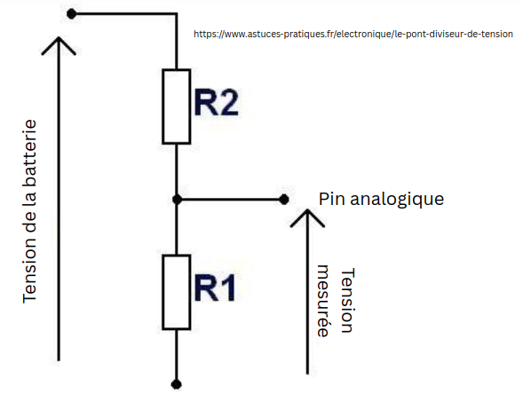
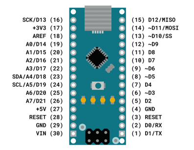
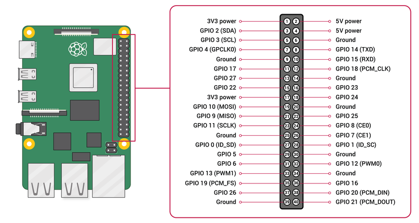

_Documentation de l'état de la voiture en 2026/2027_  
# Low level
Le low level est le code qui tourne sur l'arduino nano et qui gère la communication avec les moteurs, l'asservissement de la vitesse et la lecture du voltage des deux batteries. Il est possible, sur le hat Awake, de changer des jumpers pour rendre l'Arduino responsable du buzzer. A l'inverse, en changeant des jumpers, on peut donner la gestion de la direction, de la propulsion et la génération du 3v3 à la Raspberry Pi plutôt qu'à l'Arduino.  
Contrairement au reste du code du projet, le code qui s'y trouve tourne directement sur le microcontrolleur. Au lieu de mettre des fichiers python dans le système de fichier puis de le lancer avec uv, on utilise Arduino IDE ou un autre outil pour compiler et envoyer le code directement dans la mémoire flash de la Arduino. Le code Low Level qui se trouve dans le système de fichier de la Raspberry Pi n'est donc pas le code executé, et le changer ne sert à rien, il faut reflasher la Arduino pour changer son code.  
  
La Arduino reçoit de la Raspberry Pi une vitesse cible et une direction cible, et s'arrange pour que la voiture les respecte.

## Setup avec Arduino IDE
Le plus simple pour programmer la Arduino est d'utiliser Arduino IDE. Il suffit alors de copier-coller le code qu'on veut téléverser dans un nouveau sketch, et d'utiliser le bouton dédié dans l'IDE.  
(Il faudrait que quelqu'un qui utilise Arduino IDE complète cette section, je crois qu'il y a des trucs à faire pour ajouter les librairies)

## Setup avec Platformio
Tous les ordinateurs ne sont malheureusement pas capables de faire tourner Arduino IDE. Une alternative est d'utiliser [Platformio](https://platformio.org/install). J'utilise personellement la version CLI, installée via `apt`.   
Pour l'activer, dans mon installation, il faut activer l'environnement virtuel:
```
cd ~/.platformio/penv
source bin/activate
```
Il faut ensuite créer un projet. Créez un nouveau dossier, et mettez y les fichiers suivants:
```
Projet
├─ platformio.ini
└─ src/
   └─ ...
```
Le dossier `src/` contient le code que vous voulez téléverser sur la carte Arduino. Il faut donc copier-coller tous les fichiers de votre code dans ce dossier quand vous voulez compiler. Il peut être utile de se créer un script de compilation en bash qui s'en charge automatiquement.  
Une fois que vous avez ajouté à `src/` tous les fichiers de code, vous allez pouvoir les compiler. Pour cela, il faut indiquer à platformio comment vous souhaitez les compiler. C'est à ça que sert le fichier `platformio.ini`.  
La carte que nous utilisons est une Arduino Nano Atmega 286p Le fichier doit donc ressembler à ça:
```
[env:board]
platform = atmelavr
board = nanoatmega328
framework = arduino
targets = upload

upload_speed = 115200 # Important pour notre carte ! Ça marche pas sinon
monitor_speed = 115200

lib_deps =
	arduino-libraries/Servo
	greygnome/EnableInterrupt
```
Evidemment, il faut mettre toutes les librairies nécessaires. Au moment de l'écriture, les seules librairies utilisées par le projet sont `Servo` et `EnableInterrupt`.  
Si vous avez besoin d'une librairie que vous avez oublié d'inclure, platformio vous en informe lors de la compilation. Par exemple, si j'oublie d'indiquer que j'utilise `arduino-librairies/Servo`:
```
***************************************************************
* Looking for Servo.h dependency? Check our library registry!
*
* CLI  > platformio lib search "header:Servo.h"
* Web  > https://registry.platformio.org/search?q=header:Servo.h
*
***************************************************************
```
Il suffit alors de lancer la commande `platformio lib search "header:Servo.h"`, et d'ajouter à la liste `lib_deps` le premier resultat:
```
arduino-libraries/Servo
Library • 1.3.0 • Published on Thu Nov  6 12:05:42 2025
Allows Arduino boards to control a variety of servo motors. This library can control a great number of servos.
It makes careful use of timers: the library can control 12 servos using only 1 timer.
On the Arduino Due you can control up to 60 servos.
```
La commande pour compiler le projet est simplement:  
```
pio run -e board
```
Tout ça est un peu long la première fois, mais au moins c'est une alternative viable à Arduino IDE.

## Mesure des voltages
La Arduino mesure le voltage des deux batteries pour les transmettre à la Raspberry Pi, qui les affiche ensuite sur l'écran de la mezzanine. Dans ce but, le potentiel de la borne `+` des deux batteries passe par le connecteur Interface / Hat et arrive sur des pins analogiques de la Arduino (`A2` pour la LiPo, `A3` pour la NiMh).  
Cependant, ces voltages sont trop hauts pour la Arduino et risqueraient d'endommager les pins si on ne les protégeait pas. On utilise donc des ponts diviseurs de tension.  
  
On a alors la formule:  
$$
V_{batterie} = {\frac{R_1 + R_2}{R_1}} \times V_{mesuré}
$$
Dans le code, on fait ce calcul:
```
  voltage_LiPo = analogRead(sensorPin_Lipo) * (5.0 / 1023.0);
  voltage_NiMh = analogRead(sensorPin_NiMh) * (5.0 / 1023.0);
  voltage_LiPo = voltage_LiPo * ((r1_LiPo + r2_LiPo) / r1_LiPo);
  voltage_NiMh = voltage_NiMh * ((r1_NiMh + r2_NiMh) / r1_NiMh);
```
La formule `(5.0 / 1023.0)` correspond à un produit en croix pour obtenir le voltage mesuré. Un pin analogique discrétise le voltage qu'il reçoit (au maximum 5V) en 1024 tranches de 4.88mV, car `5V / 1024 = 4.88mV`. Après lecture, le code reçoit un nombre entre 0 et 1023. Le voltage mesuré par le pin est donc obtenu en multipliant la valeur par la largeur des tranches de voltage.  
Les résistances utilisées sur la voiture, au moment de l'écriture ont les valeurs suivantes:  
* R1 = 560 Ω
* R2 = 1 kΩ  

Les voltages mesurés sont ensuite transmis à la Raspberry Pi via la communication I²C.

## Communication avec les moteurs
Les moteurs sont actionnés par des appels à la bibliothèque Arduino Servo, mais je ne sais pas comment exactement, car il y a des drivers qui, à ce qu'on m'a dit, marchent de manière un peu mystique. Pour l'instant j'y touche pas pour pas offenser l'esprit de la machine.

## Asservissement
Faut lire [wikipedia](https://fr.wikipedia.org/wiki/R%C3%A9gulateur_PID), pour l'instant c'est trop mathématique pour moi. À coté des consignes de vitesse et de direction sont reçues par I²C et la vitesse est calculée par des interruptions déclenchées par la fourche optique et des petites formules (cf. le code), puis ça fait un lissage en renvoyant la moyenne des 3 dernières mesures.

## Communication I²C
Pour assurer la communication entre la Arduino et la Raspberry Pi, on utilise [le protocole I²C](https://fr.wikipedia.org/wiki/I2C). Les lignes SDA et SCL sont partagées par l'Arduino, la Raspberry Pi, l'écran de la mezzanine s'il est présent, l'accéleromètre de la mezzanine s'il est présent, le ToF et les deux ports I²C superflus de l'interface.  
Les pins utilisés sont:  
* A4/D18 pour la ligne SDA de la Arduino
* A5/D19 pour la ligne SCL de la Arduino  
* GPIO 2 pour la ligne SDA de la Raspberry Pi
* GPIO 3 pour la ligne SDA de la Raspberry Pi

La Arduino ne parle directement en I²C qu'à la Raspberry Pi dans le code écrit au moment de l'écriture. Cependant, il est possible d'imaginer, par exemple, que l'accéleromètre soit géré par la Arduino via l'interface I²C.  
La Raspberry Pi peut soit envoyer des données, soit demander des données à la Arduino. Chacun de ces deux évenement est géré par un callback que la bibliothèque `Wire` nous permet de définir. Dans le code, cela correspond aux fonctions `receiveEvent` (la Arduino reçoit des données) et `requestEvent` (la Raspberry Pi demande des données à l'Arduino).  
* Dans `receiveEvent`, la structure qui est reçue est envoyée de la manière suivante par la Raspberry Pi:
  ```
  data = struct.pack(
    "<ff",
    float(self.serveur.target_speed),
    float(self.serveur.direction),
  )
  ```
  La Arduino reçoit 9 octets:
  + Un octet de commande (à ignorer)
  + 4 octets de vitesse
  + 4 octets de direction
* Dans `requestEvent`, la structure envoyée est `{voltage_LiPo, voltage_NiMh, vitesse}`.

L'absence de communication I²C pendant 150 millisecondes déclenche un comportement par défaut dans la fonction `loop` où les roues avant sont remises droites et la propulsion est arrêtée. Tant que la voiture ne reçoit pas de nouvelle commande, la direction et la vitesse ne sont plus mis à jour (la voiture bouge plus, quoi), et le voltage des batteries n'est plus mis à jour non plus, parce que le code qui calcule le voltage est géré au même endroit.

## Organisation du code
_Tous les chemins sont donnés à partir de `CoVAPSy/src/low_level/src/`_  
Le code hérité de l'année dernière est stocké dans le fichier `Asserv.ino`.  
Dans le code rénové, les constantes du code (numéro des pins, constantes des moteurs, valeurs des composants...) sont stockées dans le fichier `config.ino`. Le reste du code est pour l'instant dans le fichier `AsservRefactor.ino`.  
Le code rénové est le même que l'ancien, à la différence que les constantes sont séparées, et que le fichier de configuration définit avec un `#define` soit `VOITURE1`, soit `VOITURE2`, puis en déduit le pin de la direction et les constantes des moteurs (`VOITURE1` correspond à la voiture la plus ancienne, `VOITURE2` correspond à la voiture Awake).  

## Electronique
  
  
Une version qui n'est pas la plus récente des [PCB](https://fr.wikipedia.org/wiki/Circuit_imprim%C3%A9) est stockée sur [cette page cadlab](https://cadlab.io/project/30307/dev/files) (attention à bien être sur la branche dev). La dernière version est sur l'ordinateur de Adam seulement.  
Je ne sais pas qui a fait l'électronique d'origine de la voiture 1. L'électronique de la voiture 2 a été faite par Adam l'année précedente pour le challenge Awake.

