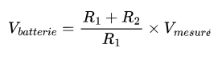

_Documentation de l'état de la voiture en 2026/2027_  
# Low level
Le low level est le code qui tourne sur l'arduino nano et qui gère la communication avec les moteurs, l'asservissement de la vitesse et la lecture du voltage des deux batteries, et le son du buzzer. Il est possible, sur le hat Awake, de changer des jumpers pour donner la gestion de la direction, de la propulsion et la génération du 3v3 à la Raspberry Pi plutôt qu'à l'Arduino.  
Contrairement au reste du code du projet, le code qui s'y trouve tourne directement sur le microcontrolleur. Au lieu de mettre des fichiers python dans le système de fichier puis de le lancer avec uv, on utilise Arduino IDE ou un autre outil pour compiler et envoyer le code directement dans la mémoire flash de la Arduino. Le code Low Level qui se trouve dans le système de fichier de la Raspberry Pi n'est donc pas le code executé, et le changer ne sert à rien, il faut reflasher la Arduino pour changer son code.  
  
La Arduino reçoit de la Raspberry Pi une vitesse cible et une direction cible, et s'arrange pour que la voiture les respecte.

### Setup avec Arduino IDE
Le plus simple pour programmer la Arduino est d'utiliser Arduino IDE. Il suffit alors de copier-coller le code qu'on veut téléverser dans un nouveau sketch, et d'utiliser le bouton dédié dans l'IDE.  
(Il faudrait que quelqu'un qui utilise Arduino IDE complète cette section, je crois qu'il y a des trucs à faire pour ajouter les librairies)

### Setup avec Platformio
Tous les ordinateurs ne sont malheureusement pas capables de faire tourner Arduino IDE. Une alternative est d'utiliser [Platformio](https://platformio.org/install). J'utilise personellement la version CLI, installée via `apt`.   
Pour l'activer, dans mon installation, il faut activer l'environnement virtuel:
```
cd ~/.platformio/penv
source bin/activate
```
Il faut ensuite créer un projet. Créez un nouveau dossier, et mettez y les fichiers suivants:
```
Projet
├─ platformio.ini
└─ src/
   └─ ...
```
Le dossier `src/` contient le code que vous voulez téléverser sur la carte Arduino. Il faut donc copier-coller tous les fichiers de votre code dans ce dossier quand vous voulez compiler. Il peut être utile de se créer un script de compilation en bash qui s'en charge automatiquement.  
Une fois que vous avez ajouté à `src/` tous les fichiers de code, vous allez pouvoir les compiler. Pour cela, il faut indiquer à platformio comment vous souhaitez les compiler. C'est à ça que sert le fichier `platformio.ini`.  
La carte que nous utilisons est une Arduino Nano Atmega 286p Le fichier doit donc ressembler à ça:
```
[env:board]
platform = atmelavr
board = nanoatmega328
framework = arduino
targets = upload

upload_speed = 115200 # Important pour notre carte ! Ça marche pas sinon
monitor_speed = 115200

lib_deps =
	arduino-libraries/Servo
	greygnome/EnableInterrupt
```
Evidemment, il faut mettre toutes les librairies nécessaires. Au moment de l'écriture, les seules librairies utilisées par le projet sont `Servo` et `EnableInterrupt`.  
Si vous avez besoin d'une librairie que vous avez oublié d'inclure, platformio vous en informe lors de la compilation. Par exemple, si j'oublie d'indiquer que j'utilise `arduino-librairies/Servo`:
```
***************************************************************
* Looking for Servo.h dependency? Check our library registry!
*
* CLI  > platformio lib search "header:Servo.h"
* Web  > https://registry.platformio.org/search?q=header:Servo.h
*
***************************************************************
```
Il suffit alors de lancer la commande `platformio lib search "header:Servo.h"`, et d'ajouter à la liste `lib_deps` le premier resultat:
```
arduino-libraries/Servo
Library • 1.3.0 • Published on Thu Nov  6 12:05:42 2025
Allows Arduino boards to control a variety of servo motors. This library can control a great number of servos.
It makes careful use of timers: the library can control 12 servos using only 1 timer.
On the Arduino Due you can control up to 60 servos.
```
La commande pour compiler le projet est simplement:  
```
pio run -e board
```
Tout ça est un peu long la première fois, mais au moins c'est une alternative viable à Arduino IDE.

### Mesure des voltages
La Arduino mesure le voltage des deux batteries pour les transmettre à la Raspberry Pi, qui les affiche ensuite sur l'écran de la mezzanine. Dans ce but, le potentiel de la borne `+` des deux batteries passe par le connecteur Interface / Hat et arrive sur des pins analogiques de la Arduino (`A2` pour la LiPo, `A3` pour la NiMh).  
Cependant, ces voltages sont trop hauts pour la Arduino et risqueraient d'endommager les pins si on ne les protégeait pas. On utilise donc des ponts diviseurs de tension.  
  
On a alors la formule:  
  
Dans le code, on fait ce calcul:
```
  voltage_LiPo = analogRead(sensorPin_Lipo) * (5.0 / 1023.0);
  voltage_NiMh = analogRead(sensorPin_NiMh) * (5.0 / 1023.0);
  voltage_LiPo = voltage_LiPo * ((r1_LiPo + r2_LiPo) / r1_LiPo);
  voltage_NiMh = voltage_NiMh * ((r1_NiMh + r2_NiMh) / r1_NiMh);
```
La formule `(5.0 / 1023.0)` correspond à un produit en croix pour obtenir le voltage mesuré. Un pin analogique discrétise le voltage qu'il reçoit (au maximum 5V) en 1024 tranches de 4.88mV, car `5V / 1024 = 4.88mV`. Après lecture, le code reçoit un nombre entre 0 et 1023. Le voltage mesuré par le pin est donc obtenu en multipliant la valeur par la largeur des tranches de voltage.  
Les résistances utilisées sur la voiture, au moment de l'écriture ont les valeurs suivantes:  
* R1 = 560 Ω
* R2 = 1 kΩ  

Les voltages mesurés sont ensuite transmis à la Raspberry Pi via la communication I²C.  
Il peut être important de noter que sur la voiture 1, on a R2 = 1.5 kΩ, jusqu'à ce qu'on refasse son électronique sur le modèle de la voiture 2.  

### Communication avec les moteurs
Les moteurs sont actionnés par des appels à la bibliothèque Arduino Servo. Je n'ai pas encore étudié le driver (un Tamiya ESC) en lui même, mais l'utilisation basique des moteurs est plutôt simple. La carte Arduino envoie des signaux [pwm](https://en.wikipedia.org/wiki/Pulse-width_modulation) au driver du moteur de propulsion ainsi que directement au moteur de direction. Pour le moteur de direction, la valeur du pwm donne au moteur l'angle qu'il doit prendre. Pour le moteur de propulsion, le pwm indique au driver la vitesse qu'on veut donner au moteur. Bien sûr, ce n'est pas une vitesse en mètre par secondes, et on a donc besoin de mesurer la vitesse avec la fourche optique, puis d'effectuer un asservissement.  
Pour les deux moteurs, la valeur 1500 pour le pwm correspond à la position neutre. Pour la direction, écrire 1500 correspond à mettre les roues droites, et pour la propulsion, cela correspond à arrêter la voiture.  
La mise en marche arrière de la voiture est un peu complexe. Il faut commencer par mettre la voiture au point neutre (arrêter le moteur) puis la mettre en reverse très fort, et revenir au point neutre avant de pouvoir reculer. Le recul se fait ensuite avec un pwm inferieur à 1500.  
La vitesse de la voiture est bridée dans le low level par les variables `motor_min_pwm` et `motor_max_pwm`, qui sont les bornes de l'intervalle de valeurs qu'on peut envoyer au moteur. Il faut changer `motor_max_pwm` si on veut faire avancer la voiture plus vite.  
Les valeurs pwm qu'on peut envoyer au moteur de direction sont également encadrées par deux variables `dir_min_pwm` et `dir_max_pwm`, mais la valeur de ces bornes change selon la voiture car elles sont spécifiques à chaque moteur.

### Asservissement
Faut lire [wikipedia](https://fr.wikipedia.org/wiki/R%C3%A9gulateur_PID), pour l'instant c'est trop mathématique pour moi. À coté des consignes de vitesse et de direction sont reçues par I²C et la vitesse est calculée par des interruptions déclenchées par la fourche optique et des petites formules (cf. le code), puis ça fait un lissage en renvoyant la moyenne des 3 dernières mesures.

### Communication I²C
Pour assurer la communication entre la Arduino et la Raspberry Pi, on utilise [le protocole I²C](https://fr.wikipedia.org/wiki/I2C). Les lignes SDA et SCL sont partagées par l'Arduino, la Raspberry Pi, l'écran de la mezzanine s'il est présent, l'accéleromètre de la mezzanine s'il est présent, le ToF et les deux ports I²C superflus de l'interface.  
Les pins utilisés sont:  
* A4/D18 pour la ligne SDA de la Arduino
* A5/D19 pour la ligne SCL de la Arduino  
* GPIO 2 pour la ligne SDA de la Raspberry Pi
* GPIO 3 pour la ligne SDA de la Raspberry Pi

La Arduino ne parle directement en I²C qu'à la Raspberry Pi dans le code écrit au moment de l'écriture. Cependant, il est possible d'imaginer, par exemple, que l'accéleromètre soit géré par la Arduino via l'interface I²C.  
La Raspberry Pi peut soit envoyer des données, soit demander des données à la Arduino. Chacun de ces deux évenement est géré par un callback que la bibliothèque `Wire` nous permet de définir. Dans le code, cela correspond aux fonctions `receiveEvent` (la Arduino reçoit des données) et `requestEvent` (la Raspberry Pi demande des données à l'Arduino).  
* Dans `receiveEvent`, la structure qui est reçue est envoyée de la manière suivante par la Raspberry Pi:
  ```
  data = struct.pack(
    "<ff",
    float(self.serveur.target_speed),
    float(self.serveur.direction),
  )
  ```
  La Arduino reçoit 9 octets:
  + Un octet de commande (à ignorer)
  + 4 octets de vitesse
  + 4 octets de direction
* Dans `requestEvent`, la structure envoyée est `{voltage_LiPo, voltage_NiMh, vitesse}`.

L'absence de communication I²C pendant 150 millisecondes déclenche un comportement par défaut dans la fonction `loop` où les roues avant sont remises droites et la propulsion est arrêtée. Tant que la voiture ne reçoit pas de nouvelle commande, la direction et la vitesse ne sont plus mis à jour (la voiture bouge plus, quoi), et le voltage des batteries n'est plus mis à jour non plus, parce que le code qui calcule le voltage est géré au même endroit.  

Les composants n'utilisent pas tous les mêmes niveaux d'alimentation. Enfin, ils pourraient tous utiliser du 3V3, mais le ToF est actuellement alimenté en 5V. Cela introduit le besoin d'avoir un level shifter, qui va transformer les signaux 3V3 en signaux 5V. Cela est dû au fait que le niveau logique HIGH de l'I²C est de [0,7 * Vdd à Vdd](https://fr.wikipedia.org/wiki/I2C#Niveaux_%C3%A9lectriques), et le Vdd n'est pas le même pour le ToF que pour le reste du circuit I²C. On prend donc le risque, sans level shifter, que le ToF ne voit pas une partie des signaux HIGH envoyés par la Raspberry Pi, et que ça casse la communication. Le level shifter utilisé est un [PCA9517-112](https://www.nxp.com/docs/en/data-sheet/PCA9517.pdf).

### Organisation du code
_Tous les chemins sont donnés à partir de `CoVAPSy/src/low_level/src/`_  
Le code hérité de l'année dernière est stocké dans le fichier `Asserv.ino`.  
Dans le code rénové, les constantes du code (numéro des pins, constantes des moteurs, valeurs des composants...) sont stockées dans le fichier `config.ino`. Le reste du code est pour l'instant dans le fichier `AsservRefactor.ino`.  
Le dossier `CoVAPSy/src/low_level/src/TestCode/` contient tout un tas de codes pour la Arduino qui n'effectuent qu'une seule fonction simple. Ils sont là pour être facilement trouvés et uploadés sur la Arduino à la place du programme d'asservissement pour tester une seule fonction de la carte.  
Le code rénové est le même que l'ancien, à la différence que les constantes sont séparées, et que le fichier de configuration définit avec un `#define` soit `VOITURE1`, soit `VOITURE2`, puis en déduit le pin de la direction et les constantes des moteurs (`VOITURE1` correspond à la voiture la plus ancienne, `VOITURE2` correspond à la voiture Awake).  
La constante `SOUND_ON` permet de définir si la carte Arduino doit émettre du son par le buzzer lors de sa mise en route ou pas.  

### Electronique
  
  
Les [PCB](https://fr.wikipedia.org/wiki/Circuit_imprim%C3%A9) qui décrivent l'électronique de la voiture 2 sont accessibles sur [cette page cadlab](https://cadlab.io/project/30307/dev/files) (attention à bien être sur la branche dev).  
Je ne sais pas qui a fait l'électronique d'origine de la voiture 1. L'électronique de la voiture 2 a été faite par Adam l'année précedente pour le challenge Awake.  
L'électronique Awake comprend deux interrupteurs. Le premier se situe à l'arrière de la voiture, sur la mezzanine. Il sert à couper le courant 5V à la carte Hat. Le deuxième est en dessous de la grosse plaque, collé au bas du chassis sur la droite de la voiture (la droite en regardant la voiture par derrière), à coté du hacheur (le driver du moteur de propulsion) et permet de le couper, et donc de couper la propulsion. **Le LiDAR n'a pas d'interrupteur et fonctionne en continue quand il est alimenté. Il faut donc débrancher la LiPo dès que l'on n'utilise plus la voiture**. Sinon, la batterie se vide vite et c'est relou le jour de la compétition, ou juste quand on veut bosser.  
Le ToF doit être un [VL53L1X-SATEL](https://www.st.com/resource/en/data_brief/vl53l1x-satel.pdf).  
La centrale inertielle doit être un [BNO055](https://www.mouser.fr/datasheet/3/1046/1/bst_bno055_ds000.pdf).  
L'écran est l'écran OLED standard pour Arduino. Je n'ai pas la référence du composant mais globalement tous les tutoriels parlent de cet écran. Il faut juste faire attention à ce que l'ordre des pins soit bon pour pouvoir le brancher: il faut avoir `Vcc, GND, SCL, SDA`.  
Lorsqu'on soude des composants électroniques, il faut essayer au maximum de les rendre intechangeables, en ne soudant pas directement le composant sur le PCB. Il est mieux de souder d'abord des ports de connexion, puis de clipser le composant sur le port. Cela permet de réparer et de débugger beaucoup plus facilement.

### Hardware
Les modèles 3D format STL utilisés pour la voiture sont stockés dans `CoVAPSy/docs/Hardware/3D_model`. Ce ne sont que ceux qui ont été faits par les membres d'Autotech. D'autres modèles 3D, comme la plaque ou les pare chocs sont stockés directement dans [le repo officiel de CoVAPSy](https://github.com/ajuton-ens/CourseVoituresAutonomesSaclay/tree/main/Hardware/pieces_mecaniques_stp_dxf).  

### Mise en route de la voiture
* Pour l'électronique Awake:  
  + Brancher les deux batteries (LiPo, NiMh)
  + Fermer l'interrupteur du hacheur qui se trouve sur la droite de la voiture, fixé sur le bas du chassis, juste à côté du hacheur et du moteur
  + Fermer l'interrupteur des microcontrolleurs, juste à côté de l'écran sur la mezzanine
  + Se ssh sur la voiture
  + Aller dans le répertoire source du high level (`cdco`)
  + Lancer le serveur (`uvrun`)
  + Aller sur le site ou utiliser l'écran pour sélectionner l'IA ou un programme de télécommande (Le site se trouve à http://ip:8001/, avec l'ip affichée sur l'écran de la voiture. Cette ip est 192.168.1.21 sur Intech_Premier)
  + Pour télécommander la voiture, il faut d'abord connecter une manette en bluetooth à la Raspberry Pi. Pour mettre la manette en mode connection, il faut tenir appuyé le bouton Home (au milieu de la manette vers le bas) et le bouton de connection (petit bouton en haut à gauche du pad central de la manette) jusqu'à ce que les LEDs du pad central se mettent à clignoter en violet.  
  L'adresse MAC de la manette de PS4 est `C4:5D:FD:05:06:07`. On execute ensuite `bluetoothctl`, puis `connect C4:5D:FD:05:06:07`.  
  À chaque fois que je le fais, je dois lancer le REPL de bluetoothctl une première fois, lancer la commande `connect`, puis ça marche pas, et il faut `exit` puis recommencer et là ça marche.
* Pour l'électronique de la première voiture:
  + Effectuer les mêmes étapes que pour l'électronique Awake, plus fermer l'interrupteur qui se trouve sur l'arrière de la boite noire en dessous de l'écran (par derrière je veux dire entre la boite et le point de montage de la caméra). Le serveur est censé se lancer automatiquement, sans avoir besoin de se ssh. L'ip de la voiture sur IntechPremier est 192.168.1.20.

### Résolution de bugs
* Si la direction ne marche pas, peut être que le code de la Arduino est compilé pour la mauvaise voiture. Le pin de la direction n'est pas le même sur l'électronique Awake et la nouvelle électronique. Un message est envoyé sur l'output serial quand la Arduino effectue son setup pour indiquer quelle version du code est dessus.
* Si l'I²C ne marche pas, peut être que le level shifter a cramé. Sur l'électronique Awake, il est situé sur le dessous du PCB Hat. Je recommande de programmer la Arduino pour qu'elle envoie un signal periodique sur ses ports I²C puis de regarder à l'oscilloscope où le signal disparaît.
* Si les cartes Arduino et Raspberry Pi ne s'allument pas parce que le hat ne reçoit pas ses 5v, ou si il n'y a pas de courant là où il devrait y en avoir, il peut être utile de prendre un voltmètre et, en partant de la batterie, suivre la trace qui transporte le voltage qui nous interesse jusqu'à trouver l'endroit où on le perd. La cause peut être un point de soudure qui a lâché, et on peut le vérifier en appuyant sur le point par différents angles pour vérifier si le forcer à se coller au cuivre dans le PCB rétablit la connexion.
